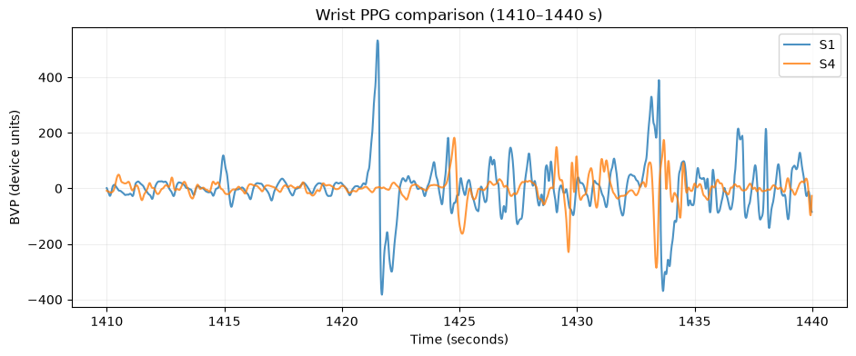
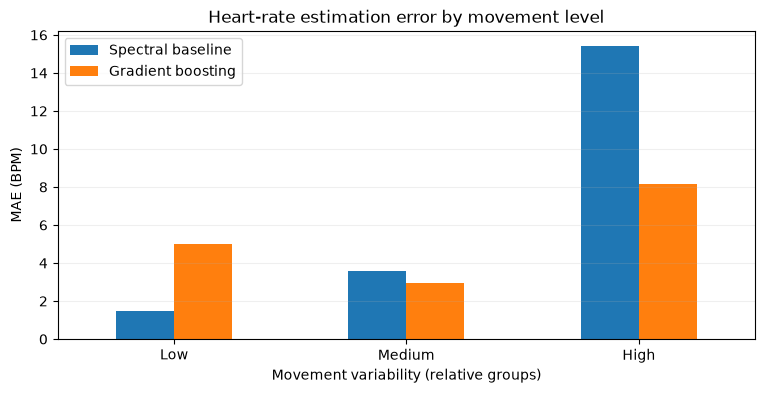
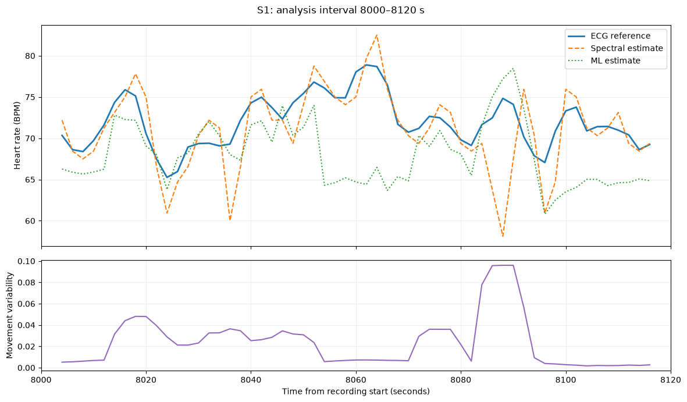

# Heart-rate estimation from wrist PPG: exploration, baseline, ML model and AI agent

**Dataset:** PPG-DaLiA · **Implementation:** three Jupyter notebooks · **Scope of reported model metrics:** participants S1 and S4 evaluated

## Summary

I built a notebook-based prototype to inspect wrist physiological signals, estimate heart rate, and explain computed results through an AI agent. The project began with an interpretable PPG spectral baseline, then tested whether a small supervised model using PPG and wrist-acceleration features could improve it. Finally, an agent was connected to one analysis function that evaluates a requested segment and reports its results and limitations.

On **S1's held-out later recording period** (917 overlapping windows), the selected gradient-boosting model achieved **5.37 BPM MAE**, versus **6.83 BPM MAE** for the filtered-PPG spectral baseline. The model performed better overall and particularly in the higher-motion windows, but the baseline was better in the lowest-motion group. This is a limited same-participant, offline evaluation—not evidence of accuracy for new people or a clinical application.

## 1. Understanding the data and problem

PPG-DaLiA contains wearable recordings from **15 participants** performing everyday activities. Wrist **BVP/PPG** measures light-based changes related to the blood-volume pulse, while wrist acceleration captures movement. The wrist signals used here are sampled at **64 Hz (PPG)** and **32 Hz (three-axis acceleration)**. An ECG-derived reference gives average heart rate for **8-second windows**, with a new label every **2 seconds**.

The main problem is that wrist movement and sensor contact can distort PPG. A prominent oscillation in the wrist signal might be a pulse, a motion artifact, or a harmonic. The aim was therefore not just to produce BPM numbers but to check when estimates agree with the ECG-derived reference, when they fail, and what the agent can responsibly say about them.

The **ECG-derived reference was not provided as a prediction feature or used at inference time**. It was the supervised learning *target* for the ML model and the reference for evaluation. The agent reads it only as part of already-computed evaluation summaries.

## 2. Data exploration and observations — Notebook 01

I first inspected published participant characteristics (age, gender, skin type and reported exercise frequency) and then explored **S1 and S4**. Across all 15 participants, ages range from **21 to 55** and the group includes **8 women and 7 men**.

| Recording / check | S1 | S4 |
|---|---:|---:|
| Age | 34 | 25 |
| Wrist PPG duration | 153.53 min | 152.50 min |
| PPG samples | 589,568 | 585,600 |
| ECG-derived HR labels | 4,603 | 4,572 |
| Non-finite PPG, acceleration or HR values | 0 | 0 |
| Mean reference HR over entire recording | 74.8 BPM | 87.9 BPM |

In an S1 interval during the study's **table-soccer (foosball)** activity, rapid acceleration changes appeared near large PPG disturbances (notably around 1421–1422 and 1433–1435 seconds). This is **consistent with motion-related interference**, although the accelerometer cannot identify a specific action such as shooting, blocking, or switching rods. When plotting S1 and S4 at identical elapsed times, those times do **not necessarily represent the same activity** in both recordings.

*Figure 1 — PPG signals at 1410–1440 seconds. The conspicuous S1 disturbances motivated investigating motion sensitivity; this plot alone does not establish their cause.*

The EDA also showed that reference heart rate varies substantially across the session and between participants. I avoided concluding that S1's exercise-frequency score explains a particular heart-rate response: neither the histogram nor this small participant sample establishes that causal relationship.

## 3. Methods and experiments — Notebook 02

### A. Interpretable spectral baseline

I divided each wrist PPG recording into **8-second windows with a 2-second stride**. For each window, a **Welch power spectrum** identified the strongest frequency in a plausible pulse range (**0.65–3.5 Hz**); multiplying this frequency by 60 produced a BPM estimate. I compared raw PPG with PPG processed using a **third-order 0.7–3.5 Hz Butterworth bandpass filter**, using the same Welch estimator for both so filtering was the main difference.

On **all 4,603 S1 windows**, the raw method produced **12.00 BPM MAE** and the filtered method **10.05 BPM MAE**. Their signed mean errors were **−6.31 BPM** and **−2.77 BPM**, respectively. Filtering helped on average but did not remove all disturbances: motion-related frequencies can fall inside the pulse band, and the largest spectral peak need not represent the heartbeat. The 4096-point FFT uses zero-padding; it does not create additional information beyond the 8-second window.

### B. Trained model

I then trained a **Histogram Gradient Boosting Regressor**, using **12 engineered features** from synchronized PPG and acceleration windows: spectral BPM, spectral concentration and entropy, frequency-band fractions, PPG variability, and accelerometer magnitude/axis variability and change. This is feature-based machine learning on time-series windows, not an end-to-end sequence model. The ECG-derived HR serves as the label *during training*, never as an input feature.

To avoid random mixing of highly overlapping windows, I split S1 **chronologically: earlier 60% for training, next 20% for validation, last 20% for test**, with a gap of four window steps at each boundary. The resulting split contained **2,761 training**, **917 validation**, and **917 test** windows. Model settings and feature selection were chosen using validation results, not the test set.

### C. What I changed and why

Training-only Spearman correlations suggested that movement features had substantial associations with reference HR (for example, **ACC change 0.776**, **ACC magnitude std 0.752**), but those associations could reflect activity patterns rather than a causal physiological link. I therefore tested feature groups rather than selecting features from correlation alone.

| Candidate (best of two settings) | Features | Validation MAE |
|---|---:|---:|
| Filtered spectral baseline (no training) | — | **9.586 BPM** |
| PPG features only | 7 | **7.597 BPM** |
| Acceleration features only — diagnostic | 5 | **5.107 BPM** |
| All PPG + acceleration features | 12 | **4.896 BPM** |
| Reduced feature set | 9 | **4.703 BPM** |
| **PPG + acceleration, without `ACC change`** | **11** | **4.677 BPM** |

The best validation candidate used **11 features**, excluding `ACC change`, with `max_iter=250`, `max_leaf_nodes=31`, learning rate `0.05` and L2 regularization `1.0`. I then retrained this selected configuration on training plus validation data and evaluated on the untouched test portion.

An interesting unsuccessful assumption was that **`ACC change` must be essential** because it had a high correlation with HR and looked important in early diagnostics. After retraining, the model **without it** scored better on validation. Also, the 9-feature candidate was not better than the 11-feature candidate. This demonstrates why feature relevance should be tested as part of a model, not decided from one statistic. The strong ACC-only validation result is also a warning that activity context may be acting as a shortcut.

## 4. Results and error analysis

**Final held-out test performance, S1 (917 windows):**

| Method | MAE | RMSE |
|---|---:|---:|
| Filtered spectral baseline | **6.83 BPM** | **13.26 BPM** |
| Selected gradient-boosting model | **5.37 BPM** | **7.76 BPM** |

This is a reduction of **1.46 BPM in MAE (approximately 21%)** and **5.50 BPM in RMSE**. The difference between the full-recording baseline MAE (10.05) and test-period baseline MAE (6.83) is expected because they cover different periods; they should not be presented as the same comparison.

Grouping test windows into three approximately equal groups by *acceleration-magnitude variability* showed a more nuanced picture:

| Test movement group | Windows | Spectral baseline MAE | ML MAE |
|---|---:|---:|---:|
| Low | 306 | **1.48 BPM** | 5.00 BPM |
| Medium | 305 | 3.56 BPM | **2.95 BPM** |
| High | 306 | 15.43 BPM | **8.15 BPM** |

*Figure 2 — Lower is better. Gradient boosting helps most for higher-movement windows, but the simpler spectral method wins in low-movement windows.*

These observations support the idea that wrist motion complicates frequency-based estimation. They do **not** prove that movement caused every error or that the model is robust to unseen participants, sensors or activities. In particular, the strong predictive value of acceleration may partly arise from activity-specific correlations in this recording.

## 5. Tool-calling AI agent — Notebook 03

I created one Python analysis function, **`analyze_segment(subject, start_seconds, duration_seconds)`**, which reads saved **held-out test predictions** and returns computed means, MAE, maximum ML error, movement variability, window count and limitations. A separate plot function displays the **same selected windows**, so the generated explanation can be checked visually. Neither function estimates HR from the ECG reference: predictions were already computed from wrist inputs in Notebook 02.

The text agent uses a system prompt instructing it to **call the analysis tool first, report only computed numerical results, distinguish observations from hypotheses, acknowledge uncertainty, and avoid diagnosis or claims of clinical validity**. There is a lightweight local **Ollama** interface, plus an optional **OpenAI API** implementation; no UI or deployment is required.

For the saved example, **S1, 8000–8120 seconds (57 complete windows)**, the analysis function returned:

| Computed quantity | Value |
|---|---:|
| ECG reference mean | **71.92 BPM** |
| Spectral mean / MAE | **71.00 / 2.41 BPM** |
| ML mean / MAE | **68.04 / 4.63 BPM** |
| Maximum absolute ML error | **14.48 BPM** |
| Mean acceleration-magnitude variability | **0.024**, in dataset-derived units |

The **spectral baseline is better on this particular segment**, even though gradient boosting performed better on the test period overall. The agent should explain that difference rather than assume the trained model always wins.

*Figure 3 — The exact held-out interval summarized for the agent: reference and both predictions above; movement variability below.*

### Local LLM experiments, including limitations

I initially considered **MedGemma 4B** because it is medically specialized. When I attempted to supply the analysis function through Ollama, the server rejected the request with **“does not support tools” (HTTP 400)**. This was a useful functional limitation: medical-domain specialization does not imply tool-calling support. I switched to **Qwen3 4B**, which completed a tool-call → Python analysis → answer workflow in the saved notebook. The **OpenAI Responses API** implementation is included as an alternative, but the uploaded notebook does **not** show a live OpenAI API execution.

The Qwen output reproduced the computed values and included uncertainty and no-diagnosis caveats. It was **not flawless**: it loosely labeled the spectral estimate as an “ECG reference” in one phrase and inferred “low” motion from a value without a calibrated threshold. The underlying tool output and plots are therefore the source of truth; agent prose still needs verification. I would tighten the prompt and add a simple output-checking step before trusting repeated reports.

## 6. What works, what is incomplete, and next steps

**Works:** Loading and visualizing selected signals; comparing participants in EDA; complete-recording spectral estimates; chronological model training and evaluation; feature-set selection; held-out test export; deterministic segment analysis; local tool calling with Qwen3 4B; and plots aligned to the analyzed segment.

**Incomplete / limitations:**

- **Generalization:** ML evaluation was run on **S1 only**. S4 was explored in EDA, not included in the saved training/test run. Testing later time periods of a known participant is different from testing unseen people.
- **Activity/temporal confounding:** Activities occur in sequence, so chronological train, validation and test sets may have different activity distributions. Acceleration features could capture those patterns instead of recovering pulse frequency.
- **Non-causal preprocessing:** The Butterworth `sosfiltfilt` filter was applied over the entire recording before time splitting; this uses samples from both directions and would need replacement or split-aware treatment for strict real-time evaluation. Split gaps reduce direct window overlap but do not turn the filter into a causal one.
- **Sampling and reference quality:** The 8-second windows overlap by 6 seconds, so error observations are dependent. ECG-derived reference labels are useful comparison measurements, not perfect instantaneous ground truth. Motion and other artifacts can affect signals.
- **Model scope:** Only simple engineered features and two modest hyperparameter settings were compared. There is no confidence calibration, uncertainty interval or medical validation.
- **Agent:** Its input is an aggregate of stored test predictions, not the raw waveform; the model's wording may occasionally overinterpret it. The OpenAI path has not been validated with a live call in the uploaded outputs.

**Next steps, in priority order:** (1) perform **leave-one-subject-out evaluation** on several or all participants; (2) break errors down by correctly aligned activity intervals and check whether motion features help beyond activity shortcuts; (3) test a causal/split-aware filter and more reliable signal-quality indicators; (4) add explicit checks that generated summaries match returned JSON and avoid unsupported labels; and (5) only if needed, compare with a modest 1D CNN using raw windows.

## 7. Resources, AI assistance and verification

- **Data and documentation:** [UCI PPG-DaLiA](https://archive.ics.uci.edu/dataset/495/ppg-dalia), [original PPG-DaLiA paper](https://doi.org/10.3390/s19143079), and [published participant characteristics referenced in EDA](https://doi.org/10.1080/24751839.2021.1987706).
- **Libraries:** NumPy, pandas, SciPy (filtering/Welch), Matplotlib and scikit-learn (`HistGradientBoostingRegressor`, MAE/RMSE, permutation importance). Jupyter notebooks hold the complete steps and saved outputs.
- **AI assistance:** ChatGPT was used to help design, write, troubleshoot and reorganize prototype code and explanations. Ollama models were evaluated for local agent feasibility: **MedGemma 4B failed at function calling**; **Qwen3 4B performed the demonstrated tool-calling workflow**. An OpenAI API function was implemented but not exercised in the submitted notebook output.
- **Verification approach:** I inspected waveforms alongside acceleration; checked prediction/reference alignment and window counts; compared raw and filtered baselines with the same spectral method; preserved chronological train/validation/test separation for model selection; compared model variants on validation before evaluating on test; and checked the agent's JSON metrics against its plotted segment. I also identified a wording mistake and unsupported inference in one generated answer rather than treating LLM output as ground truth.

## 8. Approximate time spent

The task was divided onto two days. The first day I spent roughly 2 hours, where I analyzed the data and got a simple POC flow working. The second day I spent 3-4 hours to test different models, try various experiments, and prepare an organized report.

So the total is 5-6 hours.

---

**Reproduction:** Run `01_eda_visualization.ipynb`, then `02_heart_rate_estimation.ipynb` (exports `../Data/test_predictions.csv`), then `03_ai_agent.ipynb`. Update the local dataset path as needed. Dataset files, exported predictions and any actual API keys should not be included in the submitted repository or ZIP. The agent's stored example only covers the saved held-out test range, not arbitrary periods of the original recording.
